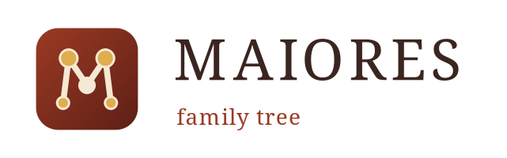
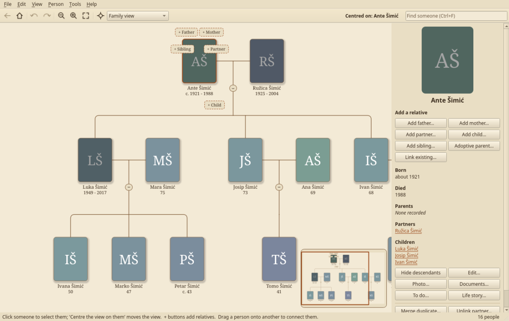
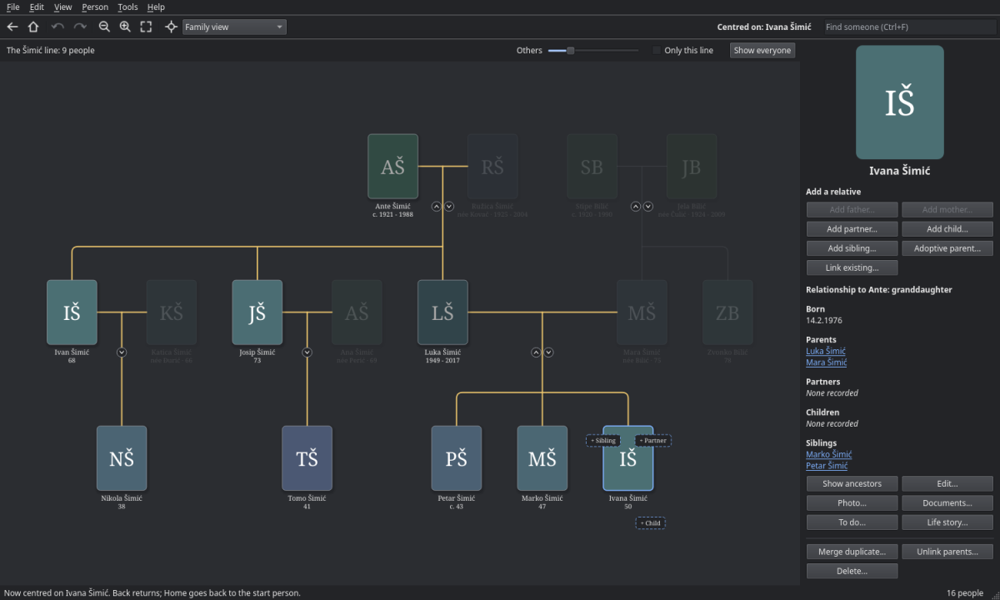
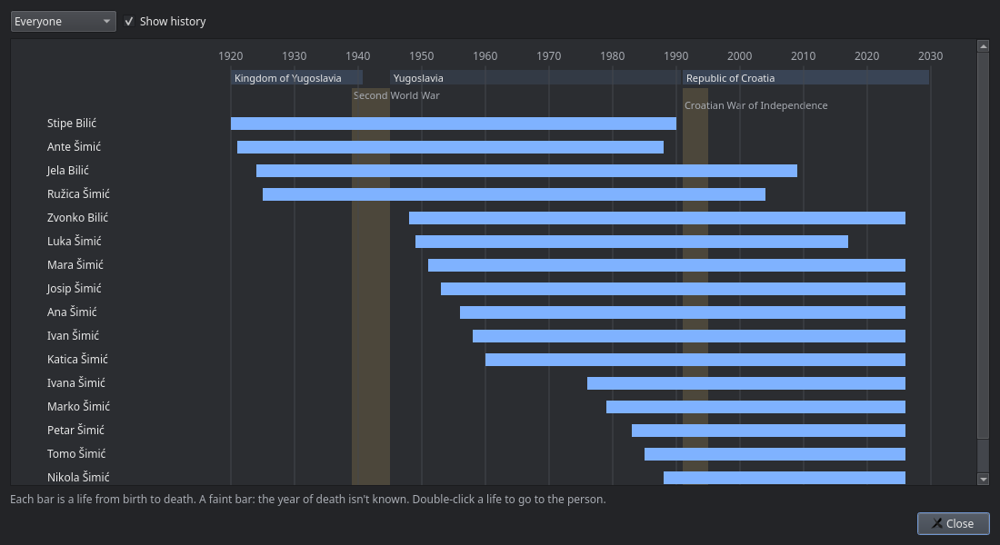
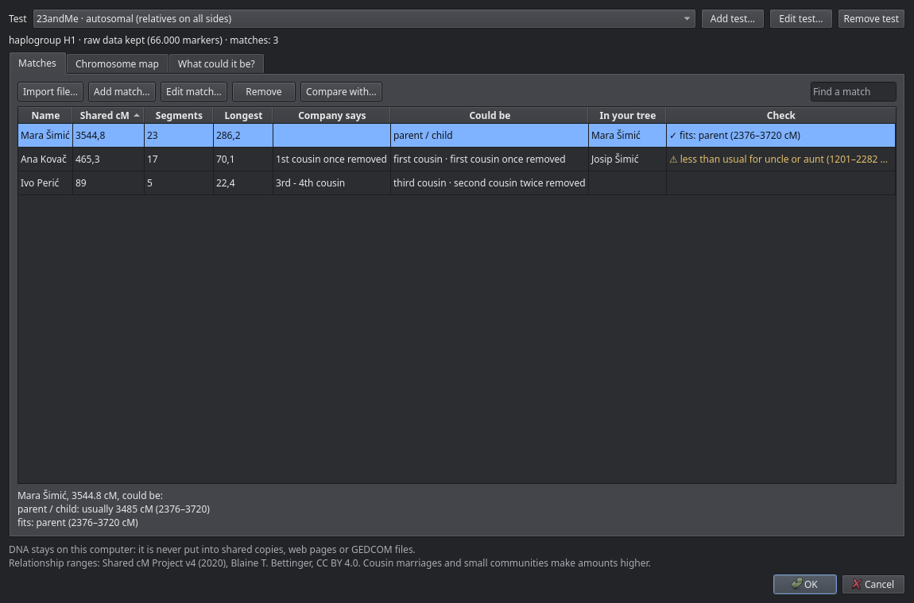

<p align="center"></p>

**Maiores** is a free family tree program for Windows, Mac and Linux. Your tree stays on
your computer: nothing is uploaded anywhere unless you choose to share it.

*Maiores* is Latin for "the ancestors", what the Romans called those who came before them.



> **Early release.** The program is checked by thousands of automated tests (random use,
> broken files, every action on every chart, large trees), but it has not yet been used by
> many real people. Please **keep a backup** of your tree, and report anything odd —
> see [Help and bug reports](#help-and-bug-reports).

## What it does

- **See the family:** a family view around anyone, with both parents' sides; descendant
  chart, pedigree, bow tie and fan charts; fold branches up or down; highlight a family
  line (everyone born with one surname) while the rest fades; an overview map.
- **Record it properly:** dates as they appear in old records (about, before, between,
  Julian dates, double years like 1708/09), places with their older names, other names,
  godparents and witnesses, sources and citations, documents and photos with faces marked,
  life stories and a research to-do list.
- **Views:** lifelines on a timeline over the history of the time, a gallery of every
  picture, statistics with charts, a map of where the family lived.
- **DNA:** record DNA tests and matches, import match lists and segment files
  (MyHeritage, FamilyTreeDNA, GEDmatch, 23andMe), see what a shared amount could mean and
  whether your tree agrees with it, a chromosome map, and compare two relatives' raw DNA
  files on your own computer. DNA never leaves your computer.
- **Bring trees in, take them out:** GEDCOM files from MyHeritage, Ancestry/Maiores
  Maker, Findmypast, Gramps and others come in whole — what the program doesn't use is
  kept and written back out unchanged. Combine a relative's tree with yours, find
  duplicates.
- **Share:** reports and books, wall posters, PDF and pictures; a single web page that
  opens in any browser (optionally locked with a password); or show the tree live to
  phones on your Wi-Fi. Living people can be hidden in anything you share.
- **18 languages,** themes (dark, light, old paper), undo for everything.

| | |
|---|---|
|  |  |
|  | |

## Download

Get the newest version from **[Releases](../../releases/latest)**:

| Computer | File |
|---|---|
| Windows 10 or 11 | `Maiores.<version>.setup.exe` |
| Mac with an Apple chip (M1 and newer) | `Maiores.<version>.Apple.chip.dmg` |
| Older Mac with an Intel chip | `Maiores.<version>.Intel.dmg` |
| Ubuntu, Debian, Mint | `maiores_<version>_amd64.deb` |

The `.zip` and `.tar.gz` files are the same program without an installer.

The installers are not signed yet, so your computer will warn you the first time:

- **Windows:** "Windows protected your PC" → *More info* → *Run anyway*.
- **Mac:** right-click the app → *Open* → *Open*.

## Running from source

You need Python 3.12 or newer.

```
python -m venv .venv
.venv/bin/pip install -r requirements.txt        # On Windows: .venv\Scripts\pip
.venv/bin/python app.py
```

`python -m unittest discover -s tests` runs the tests; `python tools/check.py` runs every
check, and `python tools/build.py` makes the program and its installer for your system.

## Help and bug reports

- **Something wrong, or an idea?** Open an [issue](../../issues). Say what you did, what
  happened and what you expected; a screenshot helps. Please never attach your real
  family tree — describe the problem instead, or use the sample family ("Try a
  sample family" on the start page).
- **A question about using it?** Ask in [Discussions](../../discussions).

## Support the project

Maiores is free and will stay free. If it is useful to you and you would like to say
thank you, you can support its development with the **Sponsor** button at the top of this
page (GitHub Sponsors or [PayPal](https://paypal.me/shyrkhan)). Support is a thank-you, not a
purchase: everyone gets the same program and the same help.

## Licence

Maiores is free software under the **GNU General Public License, version 3 or later**
(see [LICENSE](LICENSE)): you may use it, copy it, share it and change it; if you give
others a changed version, you must share its source code under the same licence.

It includes other people's work, listed in [THIRD_PARTY.txt](THIRD_PARTY.txt): Qt and
PySide6 (LGPL), the Noto Serif font (OFL), the Shared cM Project figures (Blaine T.
Bettinger, CC BY 4.0), the HapMap genetic map, and map pictures from OpenStreetMap.
